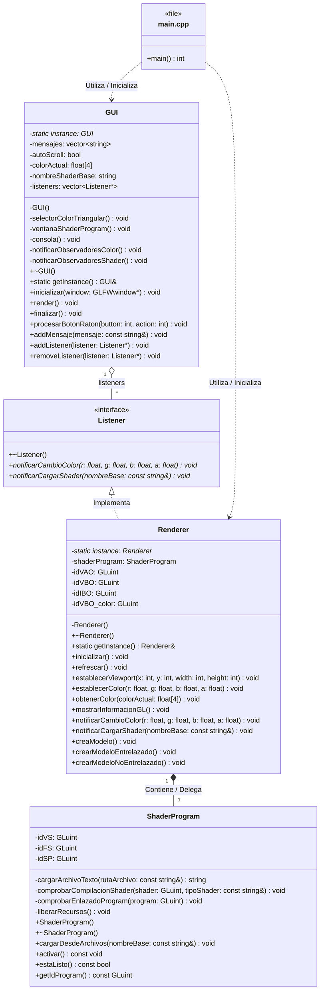

# Prácticas: Programación de Aplicaciones Gráficas (PAG)  
**Profesor:** Ángel Luis García Fernández  
**Alumno:** Juan Carlos Enríquez Muñoz  
**Año:** 2026

---
## Versión 2: Renderer

###  Resumen de Cambios Realizados

En esta práctica se ha extendido el motor gráfico desacoplando la interfaz de usuario de la lógica de renderizado mediante la integración de la biblioteca **Dear ImGui** y la implementación del patrón obsevador

#### 1. Integración de Dear ImGui
* **Selector de Color de Fondo (`COLOR DE FONDO`):** Se ha añadido una ventana interactiva para modificar el color de fondo a través de un selector de color triangular.
* **Consola de Eventos Interna (`CONSOLA`):** Se ha diseñado una ventan con área de desplazamiento, botón de limpiado y checkbox de *auto-scroll* para mostrar los mensajes por consola de la aplicación directamente en la interfaz.

#### 2. Arquitectura y Patrones de Diseño
* **Patrón Singleton:** Implementado en las clases `PAG::Renderer` y `PAG::GUI` para centralizar la gestión del motor gráfico y de la interfaz respectivamente.
* **Patrón Observador (Observer):**
    * **`PAG::Listener` (Interfaz/Abstracta):** Define el contrato `notificarCambioColor(r, g, b, a)` para los objetos interesados en reaccionar a cambios en la GUI.
    * **`PAG::GUI` (Sujeto/Publicador):** Gestiona la lista de observadores (`std::vector<Listener*>`). Al interactuar con la rueda de color, emite una notificación a los observadores sin tener dependencia directa de OpenGL o `PAG::Renderer`.
    * **`PAG::Renderer` (Observador Concreto):** Implementa `PAG::Listener` y se suscribe a `PAG::GUI` durante su método `inicializar()`. Al recibir la notificación, actualiza el estado de `glClearColor`.

#### 3. Refactorización del Bucle Principal (`main.cpp`)
* Se han eliminado todas las llamadas directas a funciones OpenGL de `main.cpp`.
* El ciclo de renderizado llama ordenadamente a `PAG::Renderer::getInstance().refrescar()` seguido de `PAG::GUI::getInstance().render()`.

---

## Versión 3: Primer Triángulo

En esta práctica se ha avanzado en el pipeline de renderizado desacoplando los archivos GLSL de C++ y añadiendo soporte para múltiples atributos por vértice (posición y color interpolado).

### 1. Carga Dinámica de Shaders GLSL desde Disco
* **Extracción a Archivos Externos:** El código GLSL se ha extraído a los archivos independientes `pag04-vs.glsl` (Vertex Shader) y `pag04-fs.glsl` (Fragment Shader).
* **Lectura Dinámica (`cargarArchivoTexto`):** Se implementó el método auxiliar privado en `PAG::Renderer` para leer el código fuente de los shaders en tiempo de ejecución utilizando `std::ifstream` y `std::stringstream`.
* **Verificación de Errores (`comprobarComprobacionShader` y `comprobarEnlazadoProgram`):** Se agregaron métodos de control que consultan la bitácora de OpenGL (`glGetShaderInfoLog` y `glGetProgramInfoLog`) y lanzan excepciones `std::runtime_error` en caso de fallos de compilación o enlazado.

### 2. Paso de Atributos e Interpolación de Colores
* **Atributo 0 (Posición):** Declarado en el Vertex Shader mediante `layout (location = 0) in vec3 posicion`.
* **Atributo 1 (Color):** Declarado en el Vertex Shader mediante `layout (location = 1) in vec3 color`.
* **Interpolación en Fragment Shader:** El Vertex Shader envía el color al Fragment Shader mediante una variable de salida (`out vec3 vColor`), permitiendo que el rasterizador interpole los colores a lo largo de la superficie del triángulo creando un gradiente.

### 3. Organización de VBOs (Entrelazados vs No Entrelazados)
Se implementaron dos estrategias para la gestión de buffers de vértices en `PAG::Renderer`:
* **VBOs No Entrelazados (`crearModeloNoEntrelazado`):** Utiliza dos buffers independientes (`idVBO` para posiciones e `idVBO_color` para colores).
* **VBO Entrelazado (`crearModeloEntrelazado`):** Utiliza una estructura C++ (`struct Vertice`) contigua en memoria y un único buffer (`idVBO`), haciendo uso de `sizeof(Vertice)` como *stride* y `offsetof` para calcular el desplazamiento (*offset*) de cada atributo.

---
## Versión 04: Gestionando Shader Programs

En esta práctica se ha completado el desacoplamiento de la compilación y enlazado de shaders fuera de `PAG::Renderer`, encapsulándolo en una clase dedicada y añadiendo control de carga interactiva desde la interfaz de usuario.

### 1. Encapsulamiento en la Clase `PAG::ShaderProgram`
* **Principio de Responsabilidad Única (SRP):** Se extrajo de `PAG::Renderer` toda la lógica asociada al ciclo de vida de los shaders (creación, lectura de ficheros `.glsl`, compilación de Vertex/Fragment Shader, enlazado del programa, liberación de recursos y activación con `glUseProgram`).
* **Seguridad de Memoria de Vídeo:** `ShaderProgram` administra internamente los identificadores de la GPU (`idVS`, `idFS`, `idSP`), ofreciendo el método `estaListo()` para que `Renderer` verifique la validez del estado antes de emitir órdenes de renderizado.
* **Manejo de Excepciones:** Ante cualquier fallo de apertura de archivo, compilación o enlazado, `ShaderProgram` captura el log técnico de OpenGL y lanza una excepción `std::runtime_error` que es enviada a la **CONSOLA** de ImGui.

### 2. Interfaz Interactiva en Dear ImGui (`Shader Program`)
* **Control de Entrada de Texto (`ImGui::InputText`):** Integración del módulo `imgui_stdlib.h` para vincular directamente objetos `std::string` (`nombreShaderBase`) al campo de texto de la interfaz con la marca `ImGuiInputTextFlags_AutoSelectAll`.
* **Botón de Carga (`ImGui::Button`):** Se incorporó la ventana interactiva `"Shader Program"` con el botón **Load**, permitiendo al usuario ingresar la parte común del nombre del shader (ej. `../pag04`) para cargarlo en tiempo de ejecución.

### 3. Extensión del Patrón Observador
* **Actualización de `PAG::Listener`:** Se añadió el método virtual `notificarCargarShader(const std::string& nombreBase)` a la interfaz del observador.
* **Flujo de Notificación:** Cuando el usuario pulsa el botón **Load** en la GUI, esta notifica a los observadores registrados. `PAG::Renderer` recibe el evento en `notificarCargarShader` y delega la lectura e instalación del nuevo shader en su atributo `shaderProgram`.

---

## Diagrama de Clases UML Actualizado

El siguiente diagrama muestra la arquitectura desacoplada de la aplicación, destacando las clases Singleton (`GUI`, `Renderer`), la nueva clase de gestión de shaders (`ShaderProgram`) y el desacoplamiento mediante la interfaz `Listener`:

