# Prácticas: Programación de Aplicaciones Gráficas (PAG)  
**Profesor:** Ángel Luis García Fernández  
**Alumno:** Juan Carlos Enríquez Muñoz  
**Año:** 2026

---
## Versión 2: Renderer

###  Resumen de Cambios Realizados

En esta práctica se ha extendido el motor gráfico desacoplando la interfaz de usuario de la lógica de renderizado mediante la integración de la biblioteca **Dear ImGui** y la implementación del patrón obsevador

#### 1. Integración de Dear ImGui
* **Selector de Color de Fondo (`COLOR DE FONDO`):** Se ha añadido una ventana interactiva para modificar el color de fondo a través de un selector de color triangular.
* **Consola de Eventos Interna (`CONSOLA`):** Se ha diseñado una ventan con área de desplazamiento, botón de limpiado y checkbox de *auto-scroll* para mostrar los mensajes por consola de la aplicación directamente en la interfaz.

#### 2. Arquitectura y Patrones de Diseño
* **Patrón Singleton:** Implementado en las clases `PAG::Renderer` y `PAG::GUI` para centralizar la gestión del motor gráfico y de la interfaz respectivamente.
* **Patrón Observador (Observer):**
    * **`PAG::Listener` (Interfaz/Abstracta):** Define el contrato `notificarCambioColor(r, g, b, a)` para los objetos interesados en reaccionar a cambios en la GUI.
    * **`PAG::GUI` (Sujeto/Publicador):** Gestiona la lista de observadores (`std::vector<Listener*>`). Al interactuar con la rueda de color, emite una notificación a los observadores sin tener dependencia directa de OpenGL o `PAG::Renderer`.
    * **`PAG::Renderer` (Observador Concreto):** Implementa `PAG::Listener` y se suscribe a `PAG::GUI` durante su método `inicializar()`. Al recibir la notificación, actualiza el estado de `glClearColor`.

#### 3. Refactorización del Bucle Principal (`main.cpp`)
* Se han eliminado todas las llamadas directas a funciones OpenGL de `main.cpp`.
* El ciclo de renderizado llama ordenadamente a `PAG::Renderer::getInstance().refrescar()` seguido de `PAG::GUI::getInstance().render()`.

---

## Versión 3: Primer Triángulo

En esta práctica se ha avanzado en el pipeline de renderizado desacoplando los archivos GLSL de C++ y añadiendo soporte para múltiples atributos por vértice (posición y color interpolado).

### 1. Carga Dinámica de Shaders GLSL desde Disco
* **Extracción a Archivos Externos:** El código GLSL se ha extraído a los archivos independientes `pag06-vs.glsl` (Vertex Shader) y `pag06-fs.glsl` (Fragment Shader).
* **Lectura Dinámica (`cargarArchivoTexto`):** Se implementó el método auxiliar privado en `PAG::Renderer` para leer el código fuente de los shaders en tiempo de ejecución utilizando `std::ifstream` y `std::stringstream`.
* **Verificación de Errores (`comprobarComprobacionShader` y `comprobarEnlazadoProgram`):** Se agregaron métodos de control que consultan la bitácora de OpenGL (`glGetShaderInfoLog` y `glGetProgramInfoLog`) y lanzan excepciones `std::runtime_error` en caso de fallos de compilación o enlazado.

### 2. Paso de Atributos e Interpolación de Colores
* **Atributo 0 (Posición):** Declarado en el Vertex Shader mediante `layout (location = 0) in vec3 posicion`.
* **Atributo 1 (Color):** Declarado en el Vertex Shader mediante `layout (location = 1) in vec3 color`.
* **Interpolación en Fragment Shader:** El Vertex Shader envía el color al Fragment Shader mediante una variable de salida (`out vec3 vColor`), permitiendo que el rasterizador interpole los colores a lo largo de la superficie del triángulo creando un gradiente.

### 3. Organización de VBOs (Entrelazados vs No Entrelazados)
Se implementaron dos estrategias para la gestión de buffers de vértices en `PAG::Renderer`:
* **VBOs No Entrelazados (`crearModeloNoEntrelazado`):** Utiliza dos buffers independientes (`idVBO` para posiciones e `idVBO_color` para colores).
* **VBO Entrelazado (`crearModeloEntrelazado`):** Utiliza una estructura C++ (`struct Vertice`) contigua en memoria y un único buffer (`idVBO`), haciendo uso de `sizeof(Vertice)` como *stride* y `offsetof` para calcular el desplazamiento (*offset*) de cada atributo.

---
## Versión 04: Gestionando Shader Programs

En esta práctica se ha completado el desacoplamiento de la compilación y enlazado de shaders fuera de `PAG::Renderer`, encapsulándolo en una clase dedicada y añadiendo control de carga interactiva desde la interfaz de usuario.

### 1. Encapsulamiento en la Clase `PAG::ShaderProgram`
* **Principio de Responsabilidad Única (SRP):** Se extrajo de `PAG::Renderer` toda la lógica asociada al ciclo de vida de los shaders (creación, lectura de ficheros `.glsl`, compilación de Vertex/Fragment Shader, enlazado del programa, liberación de recursos y activación con `glUseProgram`).
* **Seguridad de Memoria de Vídeo:** `ShaderProgram` administra internamente los identificadores de la GPU (`idVS`, `idFS`, `idSP`), ofreciendo el método `estaListo()` para que `Renderer` verifique la validez del estado antes de emitir órdenes de renderizado.
* **Manejo de Excepciones:** Ante cualquier fallo de apertura de archivo, compilación o enlazado, `ShaderProgram` captura el log técnico de OpenGL y lanza una excepción `std::runtime_error` que es enviada a la **CONSOLA** de ImGui.

### 2. Interfaz Interactiva en Dear ImGui (`Shader Program`)
* **Control de Entrada de Texto (`ImGui::InputText`):** Integración del módulo `imgui_stdlib.h` para vincular directamente objetos `std::string` (`nombreShaderBase`) al campo de texto de la interfaz con la marca `ImGuiInputTextFlags_AutoSelectAll`.
* **Botón de Carga (`ImGui::Button`):** Se incorporó la ventana interactiva `"Shader Program"` con el botón **Load**, permitiendo al usuario ingresar la parte común del nombre del shader (ej. `../pag04`) para cargarlo en tiempo de ejecución.

### 3. Extensión del Patrón Observador
* **Actualización de `PAG::Listener`:** Se añadió el método virtual `notificarCargarShader(const std::string& nombreBase)` a la interfaz del observador.
* **Flujo de Notificación:** Cuando el usuario pulsa el botón **Load** en la GUI, esta notifica a los observadores registrados. `PAG::Renderer` recibe el evento en `notificarCargarShader` y delega la lectura e instalación del nuevo shader en su atributo `shaderProgram`.

---

## Versión 05: La Cámara Virtual

En esta práctica se ha añadido soporte completo para una cámara virtual 3D utilizando la biblioteca **GLM** (*OpenGL Mathematics*).

### 1. Clase `PAG::Camara`
* **Definición Teórica:** Implementa los parámetros de visión ($eye$, $lookAt$, $up$) y la proyección de la cámara ($fovY$, $aspecto$, $zNear$, $zFar$).
* **Cálculo de Matrices:**
  * **Matriz de Visión ($V$):** Generada mediante `glm::lookAt`.
  * **Matriz de Proyección ($P$):** Generada mediante `glm::perspective`.
* **Movimientos Soportados:**
  * **Pan:** Rotación horizontal del vector de visión alrededor del eje vertical local $v$.
  * **Tilt:** Rotación vertical del vector de visión alrededor del eje horizontal local $u$.
  * **Dolly:** Traslación en el plano horizontal $XZ$ local.
  * **Crane:** Traslación vertical en el eje $Y$.
  * **Orbit:** Rotación en latitud y longitud alrededor del punto de interés $lookAt$.
  * **Zoom:** Modificación interactiva del ángulo $fovY$.

### 2. Envío de Uniforms al Vertex Shader
* Se extendió la clase `PAG::ShaderProgram` con el método `setUniformMat4`.
* Durante el ciclo de refresco (`refrescar()`), `PAG::Renderer` envía las matrices `mVis` y `mProy` al Vertex Shader `pag05-vs.glsl`.

### 3. Controles Interactivos e Interacción con el Ratón
* **Ventana ImGui (`Camera`):** Selector combo para elegir el tipo de movimiento activo y botones/sliders de control.
* **Arrastre del Ratón:** Mediante `cursor_position_callback` en GLFW, al hacer clic izquierdo y arrastrar el ratón fuera de los paneles de ImGui, se aplica el movimiento activo a la cámara.

---

## Versión 06: Modelos

En esta práctica se desacopla la gestión geométrica del renderizador (`PAG::Renderer`), introduciendo la clase `PAG::Modelo` para importar archivos OBJ e instanciar múltiples modelos en la escena.

### 1. Integración de Assimp
* Se utiliza la librería **Assimp** (*Open Asset Import Library*) mediante los flags `aiProcess_JoinIdenticalVertices`, `aiProcess_Triangulate` y `aiProcess_GenSmoothNormals`.
* Se recorren todas las mallas del archivo para consolidar vértices e índices en un único Vertex Array Object (VAO) por cada modelo.

### 2. Transformaciones de Modelado (Matriz M)
* Cada modelo administra sus vectores de **Posición**, **Rotación** y **Escala**.
* La matriz $M$ es enviada a la GPU como un uniform (`mModel`) antes del renderizado de cada objeto.
* El Vertex Shader (`pag06-vs.glsl`) procesa la posición final mediante:
  $$gl\_Position = mProy \cdot mVis \cdot mModel \cdot vec4(posicion, 1.0)$$

### 3. Controles en la Interfaz (Dear ImGui)
* **Gestor de Modelos:** Permite cargar archivos OBJ especificando la ruta relativa o mediante un selector.
* **Transformación interactiva:** Sliders de edición continua para mover, rotar y escalar el modelo seleccionado en tiempo real.
* **Modo Alambre:** Permite alternar la visualización entre `GL_LINE` y `GL_FILL`.

---

## Diagrama de Clases UML

```mermaid
classDiagram
    class Listener {
        <<interface>>
        +~Listener()*
        +notificarCambioColor(float r, float g, float b, float a)* void
        +notificarCargarShader(const string& nombreBase) void
        +notificarMovimientoCamara(TipoMovimiento tipo, float delta1, float delta2) void
        +notificarCargarModelo(const string& rutaArchivo)* void
        +notificarEliminarModelo(int indice)* void
        +notificarTransformarModelo(int indice, vec3 pos, vec3 rot, vec3 esc)* void
    }

    class TipoMovimiento {
        <<enumeration>>
        PAN
        TILT
        DOLLY
        CRANE
        ORBIT
        ZOOM
    }

    class Vertice {
        <<struct>>
        +posicion: vec3
        +color: vec3
    }

    class Modelo {
        -nombre: string
        -idVAO: GLuint
        -idVBO: GLuint
        -idIBO: GLuint
        -numIndices: GLsizei
        -posicion: vec3
        -rotacion: vec3
        -escala: vec3
        -crearBuffers(const vector~Vertice~& vertices, const vector~GLuint~& indices) void
        +Modelo(const string& rutaArchivo)
        +~Modelo()
        +dibujar(const ShaderProgram& shader) void
        +getMatrizModelado() const mat4
        +getNombre() const string&
        +getPosicion() vec3
        +getRotacion() vec3
        +getEscala() vec3
        +setPosicion(const vec3& pos) void
        +setRotacion(const vec3& rot) void
        +setEscala(const vec3& esc) void
    }

    class ShaderProgram {
        -idVS: GLuint
        -idFS: GLuint
        -idSP: GLuint
        -cargarArchivoTexto(const string& rutaArchivo) string
        -comprobarCompilacionShader(GLuint shader, const string& tipoShader) void
        -comprobarEnlazadoProgram(GLuint program) void
        -liberarRecursos() void
        +ShaderProgram()
        +~ShaderProgram()
        +cargarDesdeArchivos(const string& nombreBase) void
        +activar() const void
        +estaListo() const bool
        +getIdProgram() const GLuint
        +setUniformMat4(const string& nombre, const mat4& matriz) const void
    }

    class Camara {
        -posicion: vec3
        -puntoInteres: vec3
        -vectorArriba: vec3
        -fov: float
        -aspectRatio: float
        -zNear: float
        -zFar: float
        +getMatrizVision() const mat4
        +getMatrizProyeccion() const mat4
        +pan(float delta) void
        +tilt(float delta) void
        +dolly(float deltaX, float deltaY) void
        +crane(float delta) void
        +orbit(float deltaLat, float deltaLon) void
        +zoom(float deltaFov) void
    }

    class Renderer {
        -static instance: Renderer*
        -camara: Camara
        -movimientoActivo: TipoMovimiento
        -sensibilidadRaton: float
        -shaderProgram: ShaderProgram
        -modelos: vector~unique_ptr~Modelo~~
        -modoAlambre: bool
        -Renderer()
        +~Renderer()
        +static getInstance() Renderer&
        +inicializar() void
        +refrescar() void
        +establecerViewport(int x, int y, int width, int height) void
        +establecerColor(float r, float g, float b, float a) void
        +obtenerColor(float colorActual[4]) void
        +mostrarInformacionGL() void
        +getCamara() Camara&
        +getModelos() const vector~unique_ptr~Modelo~~&
        +isModoAlambre() const bool
        +setModoAlambre(bool activo) void
        +notificarCambioColor(float r, float g, float b, float a) void
        +notificarCargarShader(const string& nombreBase) void
        +notificarMovimientoCamara(TipoMovimiento tipo, float delta1, float delta2) void
        +notificarCargarModelo(const string& rutaArchivo) void
        +notificarEliminarModelo(int indice) void
        +notificarTransformarModelo(int indice, vec3 pos, vec3 rot, vec3 esc) void
        +aplicarMovimientoRaton(float deltaX, float deltaY) void
    }

    class GUI {
        -static instance: GUI*
        -mensajes: vector~string~
        -autoScroll: bool
        -colorActual: float[4]
        -nombreShaderBase: string
        -tipoMovimientoActivo: TipoMovimiento
        -fovAnterior: float
        -listeners: vector~Listener*~
        -GUI()
        -selectorColorTriangular() void
        -consola() void
        -ventanaShaderProgram() void
        -ventanaCamara() void
        -ventanaModelos() void
        -notificarObservadoresColor() void
        -notificarObservadoresShader() void
        -notificarObservadoresMovimientoCamara(TipoMovimiento tipo, float delta1, float delta2) void
        +~GUI()
        +static getInstance() GUI&
        +inicializar(GLFWwindow* window) void
        +render() void
        +finalizar() void
        +procesarBotonRaton(int button, int action) void
        +addMensaje(const string& mensaje) void
        +addListener(Listener* listener) void
        +removeListener(Listener* listener) void
    }

    Listener <|.. Renderer : Implementa (Observador Concreto)
    GUI "1" o-- "*" Listener : Notifica (Sujeto)
    Renderer "1" *-- "1" Camara : Composición
    Renderer "1" *-- "1" ShaderProgram : Composición
    Renderer "1" *-- "*" Modelo : Gestiona 
    Modelo "1" *-- "*" Vertice : Agrupa
    Modelo ..> ShaderProgram : Recibe en dibujar()
    Renderer ..> TipoMovimiento : Usa
    GUI ..> TipoMovimiento : Usa
```

